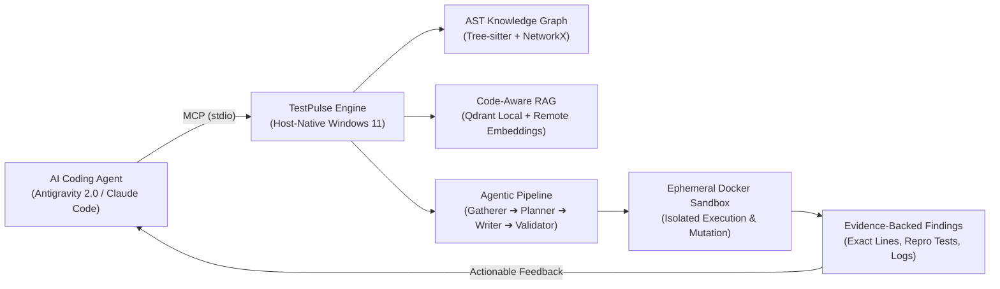
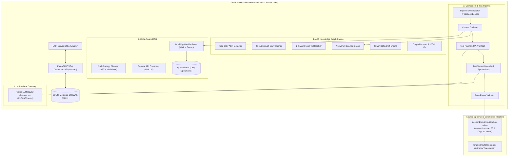

# TestPulse — Autonomous Agentic QA & Verification Platform
### Comprehensive 360° Project Overview & Engineering Blueprint

---

## 1. Executive Summary & Problem Space

### 1.1 The Fundamental Problem in AI-Assisted Software Development
The emergence of autonomous AI coding assistants (such as Antigravity 2.0, Claude Code, Cursor, and Copilot Workspace) has dramatically accelerated feature development and code authoring. However, this velocity introduces a critical structural vulnerability: **shallow and self-fulfilling testing**.

When the same AI agent that writes application logic is also tasked with writing its verification tests, it inherently suffers from severe cognitive biases:
* **Tautological Assertions**: Generating tests that assert meaningless existence checks (`assert response is not None`, `assert result != None`, `assert True`) rather than verifying domain constraints and boundary math.
* **Mock Abuse**: Mocking out the very business logic, algorithms, or database interactions under test, creating a false illusion of 100% test passing while real execution paths remain broken.
* **Happy-Path Myopia**: Only testing the specific scenario the agent just implemented, ignoring negative paths, unexpected user inputs, boundary conditions, and cross-module side effects.
* **Blind Coverage Inflation**: Writing code purely to satisfy line-coverage metrics without possessing any actual fault-detection capability (tests pass even if core arithmetic operators are inverted).

### 1.2 What is TestPulse?
**TestPulse** is an independent, autonomous, agentic QA and verification platform. It sits alongside external AI coding agents and is invoked via the **Model Context Protocol (MCP)** over standard I/O (`stdio`).

Instead of trusting the coding agent's self-generated tests, TestPulse acts as an **adversarial, objective QA auditor**:
1. It ingests the client codebase without modifying it (strict read-only inviolability).
2. It builds a high-fidelity structural Abstract Syntax Tree (AST) knowledge graph of the code.
3. It performs semantic and topological RAG to understand business rules and execution paths.
4. It plans and synthesizes **fresh, greenfield test suites** from scratch.
5. It runs these tests inside isolated, resource-capped, ephemeral Docker sandboxes.
6. It subjects the tests to a multi-stage **Anti-Shallow Validation Discipline** (including static AST smell scans and targeted mutation testing).
7. When application bugs or browser crashes are detected, it returns structured, evidence-backed findings (with exact file locations, AST context, stack traces, and reproducer tests) to the coding agent to drive targeted repairs.



---

## 2. Inviolable Laws & Architectural Guardrails

TestPulse is governed by an authoritative Project Constitution (`AGENTS.md`) and strict engineering rules (`.agents/rules/RULES.md`). These guardrails are non-negotiable:

| # | Guardrail / Inviolable Law | Architectural Implementation |
|---|---|---|
| **1** | **Client Repository Inviolability** | TestPulse **never** writes to, modifies, or deletes files in the client repository. The client repo snapshot is mounted read-only (`:ro`). All generated tests, coverage reports, and execution logs reside strictly in internal directories (`.testpulse/`, `.testpulse/runs/{run_id}/`). |
| **2** | **Component 1 Backend Scope** | Component 1 is strictly anchored to Python, FastAPI, and SQLite. It never attempts to unit-test React components or inject JSDOM mocks. Frontend testing belongs exclusively to Component 2 (Playwright E2E). |
| **3** | **Fresh Greenfield Test Generation** | TestPulse synthesizes tests completely from scratch. It never relies on pre-existing client tests to measure coverage or validate logic. |
| **4** | **Anti-Shallow Validation Discipline** | Every test must pass a 4-stage verification gauntlet: Gate 1 (Tree-sitter static AST smell scan) $\to$ Sandbox execution (`exit_code == 0`) $\to$ Coverage ratchet $\to$ Gate 2 (Targeted mutation testing — mutants must be killed) $\to$ Flakiness & Fail-to-Pass (F2P) checks. |
| **5** | **Problem A vs. Problem B Separation** | Distinguishes between internal test-quality faults (Problem A: bad imports, broken mocks, syntax errors) and actual application defects (Problem B). A failing test is never reported as an application bug unless it has passed all structural validity checks. |
| **6** | **Host-Native Execution on Windows 11** | TestPulse's FastAPI backend, LangGraph state machine, and MCP server run natively in the host Python `.venv`. Docker is used exclusively for ephemeral test runner containers and live application test stacks. |
| **7** | **Hardware & Memory Discipline** | Runs reliably on a 16GB host RAM budget. SQLite uses WAL mode (`PRAGMA journal_mode=WAL`) and `PRAGMA busy_timeout=5000`. Qdrant Local is opened and closed lazily per operation (zero file locks). Zero host RAM for PyTorch/transformers (remote-only embeddings). |
| **8** | **Uncompromised Test Quality** | LLM model tiers are loaded dynamically from `.env` via OpenRouter. Test quality and depth are never degraded to save tokens. Repairs are bounded to a maximum of 3 retries per target. |
| **9** | **Sandbox Write Safety** | Sandboxes mount the client repo read-only (`:ro`), redirect SQLite databases to `/tmp/test_sqlite.db`, and set `PYTHONDONTWRITEBYTECODE=1` to prevent write errors against read-only mounts. |
| **10** | **Pre-Baked Offline Sandboxes** | `Dockerfile.sandbox-python` pre-installs the complete FastAPI testing stack (`fastapi`, `pydantic`, `sqlalchemy`, `aiosqlite`, `pytest`, `pytest-cov`, `httpx`, etc.) enabling hermetic `--network="none"` execution. |

---

## 3. System Architecture & Component Roadmap

TestPulse is organized into three major phases and six core modular subsystems:



### 3.1 The Three Core Components

| Component | Focus | Description & Scope | Status |
|---|---|---|---|
| **Component 1** | **Code-Level Testing** | Deep structural AST extraction, code-aware RAG, multi-strategy test synthesis (Unit, Integration, Regression), ephemeral Docker sandbox execution, and dual-phase validation for Python / FastAPI / SQLite backends. | **Milestones 0–4 Completed** (Core Engine Verified) |
| **Component 2** | **Browser Testing** | Playwright E2E browser automation exercising real user flows on React/Vite frontends, capturing DOM snapshots, console logs, network errors, and visual failure traces. | Future Milestone |
| **Component 3** | **Cross-Layer RCA** | Automated Root-Cause Analysis correlating frontend UI failures and uncaught exceptions with backend API traces, database states, and AST graph nodes to produce unified diagnostic reports. | Future Milestone |

---

## 4. Deep-Dive: Core Subsystems & Methodologies

### 4.1 Subsystem 1: Native In-House AST Knowledge Graph (`src/testpulse/graph/`)
Adapted locally and vendored from Graphify (`Graphify-Labs/graphify`), TestPulse stripped all CLI bloat, benchmark scripts, and non-target languages to build an ultra-fast, in-house AST graph engine tailored specifically to Python/FastAPI and JS/TS:

* **Tree-sitter AST Extraction (`ast_extractor.py`)**: Parses source code into high-fidelity ASTs, calculating cyclomatic branching complexity (`if`, `elif`, `for`, `while`, `except`, boolean operators) and node spans.
* **Deterministic AST Body Hashing (`ast_hasher.py`)**: Implements `calculate_ast_body_hash`, which strips comments, standalone docstrings, and normalizes whitespace before computing a SHA-256 digest. This detects silent algorithmic modifications and constant tweaks even when method signatures remain unchanged.
* **FastAPI Entry Point & Dependency Detection (`entry_points.py`)**: Inspects AST decorator nodes to extract HTTP routes (`@app.get`, `@router.post`), paths, and injected service dependencies (`Depends(...)`).
* **2-Pass Cross-File Resolution (`cross_file_resolver.py`)**: 
  * Pass 1: Resolves static containment and module import edges (`EXTRACTED`).
  * Pass 2: Inferred call resolution across file boundaries (`INFERRED`), connecting route handlers to service logic and models.
* **Topological Queries (`queries.py`)**:
  * *God Node Detection*: Pinpoints high in-degree/out-degree architectural bottlenecks.
  * *Circular Import Cycle Detection*: Detects import cycles using NetworkX strongly connected components.
  * *Anti-Shallow Unit Target Selection*: Prioritizes non-trivial business logic, explicitly filtering out trivial getters, setters, and wrappers (`cyclomatic_complexity <= 1` and `< 6` lines of code).
  * *Integration Target Selection*: Prioritizes FastAPI route entry points based on downstream multi-hop graph depth.
  * *2-Hop Blast Radius Computation*: Computes the regression blast radius ($ModifiedNodes \cup Callers^2 \cup Dependencies^1$) when code changes occur.
* **Graph Diffing & Human-Readable Reporting (`diff.py`, `reporter.py`)**: Generates comprehensive Markdown summaries (`GRAPH_REPORT.md`) and interactive D3 force-directed HTML graph visualizations (`graph.html`).

### 4.2 Subsystem 2: Code-Aware RAG with Qdrant Local Mode (`src/testpulse/rag/`)
TestPulse combines structural knowledge graph walks with semantic vector search to provide complete context without blowing up LLM prompt windows or host memory:

* **Dual-Strategy Chunker (`chunker.py`)**:
  * *AST Code Chunking (1 Node = 1 Chunk)*: Slices code at function and class boundaries, prepending a structured cAST header:
    ```python
    # Node ID: services/discount_service.py:calculate_discount
    # File: services/discount_service.py (Lines 10-35)
    # Direct Callers: routes/orders.py:create_order
    ```
  * *Descriptive Text Chunking*: Semantically chunks Markdown documentation (`*.md`) and global test fixtures (`conftest.py`) by heading levels, capturing business rules that do not exist in code (such as discount percentage limits).
* **Remote-Only Embedder (`embedder.py`)**: Dispatches batch embedding requests via `litellm.embedding()` to remote models (OpenAI, Voyage, or Gemini). Zero host RAM is wasted loading local PyTorch or SentenceTransformers models.
* **Lazy Qdrant Local Indexer (`indexer.py`)**: Implements the **Critical File Lock Rule**: Every read/write operation opens `QdrantClient(path=".testpulse/qdrant")` and immediately calls `client.close()` inside a `try/finally` block. This prevents SQLite and file-lock concurrency conflicts on Windows 11.
* **Dual-Pipeline Retriever (`retriever.py`)**:
  * *Pipeline A (Graph Walk — Exact Match)*: Traverses the AST graph up to $N$ hops to gather direct callers, callees, and container classes.
  * *Pipeline B (Blindspot Sweeper — Semantic Match)*: Embeds the target symbol and performs vector search with a negative filter (`must_not`) excluding all nodes already gathered by Pipeline A. This sweeps up unlinked business documentation and markdown constraints.

### 4.3 Subsystem 3: 4-Agent Sequential Test Pipeline (`src/testpulse/pipeline/`)
TestPulse executes an autonomous 4-agent state machine designed to eliminate shallow tests and enforce strict strategy boundaries:

```mermaid
sequenceDiagram
    autonumber
    participant CG as Context Gatherer
    participant TP as Test Planner
    participant TW as Test Writer
    participant VAL as Dual-Phase Validator
    participant BOX as Ephemeral Sandbox

    CG->>TP: ContextBundle (Focal + Deps + Docs + Mocks)
    activate TP
    TP->>TW: BehaviorMatrix (Happy, Boundary, Negative cases)
    deactivate TP
    
    activate TW
    TW->>VAL: CandidateTest (Pytest suite)
    deactivate TW

    activate VAL
    Note over VAL: Phase 1: Static AST Smell Scan
    alt AST Smells Detected (Tautologies, No Asserts)
        VAL-->>TP: Reject & Loop-Back (Actionable Smell Feedback)
        Note over TP: Regenerates BehaviorMatrix (Max 3 retries)
    else Clean AST
        VAL->>BOX: Phase 2: Execute Sandbox & Coverage Ratchet
        activate BOX
        BOX-->>VAL: Exit Code, Coverage, Stderr
        deactivate BOX
        
        alt Exit Code != 0 (Problem A: Test Execution Fault)
            VAL-->>TW: Reject & Loop-Back (Stderr / Traceback)
            Note over TW: Fixes Syntax / Imports / Mocks (Max 3 retries)
        else Exit Code == 0 (Passes)
            Note over VAL: Strategy Dynamic Gate
            opt Unit Strategy
                VAL->>BOX: Targeted Mutation (Logic Inversion)
                BOX-->>VAL: Mutants Killed / Survived
            end
            opt Integration Strategy
                VAL->>BOX: 3-Run Flakiness Check (Randomized)
            end
            opt Regression Strategy
                VAL->>BOX: Fail-to-Pass Check (Fail on T0, Pass on T1)
            end
            VAL-->>CG: Status: ACCEPTED
        end
    end
    deactivate VAL
```

#### The 4 Sequential Agents:
1. **Context Gatherer (`context_gatherer.py`)**:
   * Prioritizes targets according to strategy: non-trivial functions for Unit, route entry points for Integration, and blast radius nodes for Regression.
   * Assembles a strictly separated `ContextBundle`: `focal_code`, `dependency_code`, `descriptive_context`, discovered `existing_fixtures`, and explicit `mock_policy`.
   * Enforces strategy-specific mocking rules: Unit isolates the target in memory and forbids mocking the target function itself; Integration exercises the real FastAPI `TestClient` $\to$ SQLite database flow and forbids mocking internal database tables; Regression mandates a Fail-to-Pass reproducer.
2. **Test Planner (`planner.py`)**:
   * Operates as a senior "QA Architect" using Tier-1 LLMs.
   * Generates a structured `BehaviorMatrix` specifying happy paths, boundary edges, and negative error scenarios, along with exact uncovered line targets and provenance tracking.
3. **Test Writer (`writer.py`)**:
   * Synthesizes clean, PEP-8 compliant pytest files (`CandidateTest`).
   * Adheres strictly to the mock boundaries and fixture signatures.
   * Strips conversational markdown wrappers and extracts runnable code.
4. **Dual-Phase Validator (`validator.py`)**:
   * **Phase 1: Internal Static AST Smell Detection (Tree-sitter)**:
     * *Zero Assertions*: Flags any test function without an `assert` or `pytest.raises`.
     * *Tautological Assertions*: Flags `assert True`, `assert False`, shallow existence checks (`assert x is not None`, `assert x != None`), literal comparisons (`assert 1 == 1`), and identical left/right operands.
     * *Conditional Assertions*: Flags assertions wrapped inside `if`, `for`, or `while` blocks that can silently be skipped.
     * *Swallowed Exceptions*: Flags `try...except: pass` blocks, enforcing `with pytest.raises(...)`.
     * Rejection immediately loops back to the **Planner** to generate a more rigorous matrix.
   * **Phase 2: External Dynamic Sandbox Validation**:
     * Executes inside Docker with coverage ratchet.
     * If `exit_code != 0`, routes to Problem A repair loop back to the **Writer** (up to 3 retries).
     * If `exit_code == 0`, executes strategy-specific dynamic gates:
       * **Unit Strategy (Targeted Mutation)**: Inverts arithmetic and logical operators (`<` to `>=`, `==` to `!=`, `+` to `-`) using `ast.NodeTransformer`. Rejects tests where mutants survive (`mutants_survived > 0`).
       * **Integration Strategy (Flakiness Check)**: Executes 3 runs in randomized order to detect state leakage, uncleaned database tables, or missing teardowns.
       * **Regression Strategy (Fail-to-Pass Check)**: Verifies the test fails on the pre-fix snapshot $T_0$ and passes on the post-fix snapshot $T_1$.

### 4.4 Subsystem 4: Resilient Tiered LLM Gateway (`src/testpulse/llm/router.py`)
To prevent pipeline stalls during automated runs, TestPulse routes all LLM calls through a tiered gateway:
* Reads model lists from `.env` (`TESTPULSE_TIER1_MODELS`, `TESTPULSE_TIER2_MODELS`).
* Automatically catches HTTP 429 (`RateLimitError`), 503 (`ServiceUnavailableError`), and network timeouts.
* Applies exponential backoff (1s, 2s, 4s) and automatically fails over to the next candidate model in the tier.
* Normalizes OpenRouter model prefixes to prevent bad requests.
* Sanitizes output by stripping markdown code fences (`clean_json_code_fences`) and parsing into validated Pydantic models.

### 4.5 Subsystem 5: Storage & Metadata Persistence (`src/testpulse/models/`)
* **Asynchronous SQLite Engine (`database.py`)**:
  * Utilizes SQLAlchemy 2.0 async ORM paired with `aiosqlite`.
  * Implements engine connect event listeners configuring `PRAGMA journal_mode=WAL` and `PRAGMA busy_timeout=5000` to prevent lock contention between FastAPI and MCP servers.
* **Database Models (`database.py`)**:
  * `Run`: Tracks overall execution lifecycle, strategy, target, and status (`pending`, `running`, `completed`, `failed`).
  * `Snapshot`: Client codebase snapshot metadata and Git commit hashes.
  * `TestPlan`: Serialized `BehaviorMatrix` plans and strategy metadata.
  * `GeneratedTest`: Final synthesized test code, file names, and mutation kill scores.
  * `Finding`: Defect reports with severity, category, file path, line numbers, and reproducer tests.
  * `BrowserSession`: Browser session traces, console logs, and screenshots (Component 2).
  * `RCAReport`: Cross-layer root cause analysis reports (Component 3).
* **Pydantic v2 Contracts (`schemas.py`)**: Strongly-typed schemas for all data passing across boundaries (`ContextBundle`, `BehaviorMatrix`, `CandidateTest`, `ValidationResult`, `FindingSchema`, etc.).

---

## 5. Technology Stack & Tools Reference

```
+-----------------------------------------------------------------------------------+
|                                TESTPULSE TECH STACK                                |
+-----------------------------------------------------------------------------------+
| Host Runtime        | Python 3.11+ / 3.14 (.venv on Windows 11)                   |
| Web & API Framework | FastAPI + Uvicorn (async lifespan, REST, docs)              |
| Orchestration       | LangGraph (StateGraph state machines)                       |
| AST Engine          | Tree-sitter + NetworkX (vendored & adapted from Graphify)   |
| Vector Store        | Qdrant Local Mode (embedded file-backed, lazy lifecycle)    |
| Embeddings          | Remote API (LiteLLM: OpenAI / Voyage / Gemini)              |
| LLM Gateway         | LiteLLM via OpenRouter (tiered failover, Pydantic parsing)  |
| Database            | SQLite (aiosqlite + SQLAlchemy 2.0 Async, WAL Mode)         |
| Isolated Sandbox    | Docker (python:3.11-slim, pre-baked deps, 2GB cap, no-net)  |
| Code Quality & Lint | Ruff (linter/formatter), Pyright (strict static typing)     |
| Test Framework      | Pytest, pytest-asyncio, pytest-cov, Coverage.py             |
| Protocol Adapter    | Model Context Protocol (MCP) over stdio                     |
+-----------------------------------------------------------------------------------+
```

---

## 6. Project Progression: What Has Been Done Till Now

The project follows a disciplined milestone-driven development process. Below is the chronological progression of completed milestones:

### Milestone 0: Repository Foundation, Project Constitution & Ephemeral Sandbox Baseline
* **Status**: Complete & Verified (2026-10-19)
* **Accomplishments**:
  * Formulated the project constitution (`AGENTS.md`) with 10 Inviolable Laws.
  * Codified engineering rules (`.agents/rules/RULES.md`) and specialized skills (`repo-indexing`, `test-strategy`, `sandbox-execution`, `milestone-completion`).
  * Configured Python packaging (`pyproject.toml`), environment templates (`.env.example`), and `.gitignore`.
  * Implemented `src/testpulse/core/config.py` using `pydantic-settings`.
  * Implemented async SQLite database with WAL mode and 5000ms busy timeout in `src/testpulse/models/database.py`.
  * Created baseline FastAPI application (`src/testpulse/main.py`) with health check and runs endpoints.
  * Authored `docker/Dockerfile.sandbox-python` pre-installing the full FastAPI testing stack for offline execution.
  * Verified 6/6 unit tests passing.

### Milestone 1: Native In-House AST Graph Engine with Human-Readable Reporting
* **Status**: Complete & Verified (2026-10-20)
* **Accomplishments**:
  * Cloned and adapted `Graphify` locally (`.vendor/graphify`), extracting AST parsing patterns and stripping bloat.
  * Implemented Tree-sitter AST extraction with cyclomatic branching complexity counting (`ast_extractor.py`).
  * Implemented deterministic normalized SHA-256 AST body hashing (`ast_hasher.py`) to detect logic drift.
  * Implemented FastAPI route decorator and dependency injection scanner (`entry_points.py`).
  * Built 2-pass cross-file resolver (`cross_file_resolver.py`) linking calls across files.
  * Built NetworkX directed knowledge graph (`graph_builder.py`).
  * Implemented topological query engine (`queries.py`): God nodes, circular import cycles, unit target selection with trivial getter filtering, integration target selection, and 2-hop blast radius computation.
  * Implemented graph diffing engine (`diff.py`) and Markdown / D3 force-directed HTML reporting (`reporter.py`).
  * Verified 17/17 unit tests passing.

### Milestone 2: Code-Aware RAG with Qdrant Local Mode (Lazy Open/Close)
* **Status**: Complete & Verified (2026-10-21)
* **Accomplishments**:
  * Implemented dual-strategy chunker (`chunker.py`): AST 1-node=1-chunk with cAST headers and markdown heading-based splitting.
  * Implemented remote-only API embedder (`embedder.py`) with zero host RAM overhead.
  * Implemented lazy Qdrant Local indexer (`indexer.py`) enforcing the strict `try/finally: client.close()` file-lock rule.
  * Implemented dual-pipeline retriever (`retriever.py`): Pipeline A (Graph Walk exact match) + Pipeline B (Blindspot Sweeper semantic vector search excluding Pipeline A nodes).
  * Verified 24/24 unit tests passing.

### Milestone 3: Multi-Strategy Context Gatherer & Test Planning Agent (Component 1)
* **Status**: Complete & Verified (2026-10-23)
* **Accomplishments**:
  * Defined Pydantic v2 data contracts (`StrategyType`, `ContextBundle`, `BehaviorCase`, `BehaviorMatrix`).
  * Implemented resilient tiered LLM router (`router.py`) with automatic failover on 429/503/timeout and markdown fence cleaning.
  * Implemented multi-strategy `ContextGatherer` agent supporting Unit, Integration, and Regression strategies with dynamic hop-depth and strategy-specific mock boundary enforcement.
  * Implemented `TestPlanner` agent ("QA Architect") synthesizing structured `BehaviorMatrix` plans with happy, boundary, and negative scenarios.
  * Verified 39/39 unit tests passing.

### Milestone 4: Greenfield Test Synthesis (Writer Agent) & Dual-Phase Validator (Component 1)
* **Status**: Complete & Verified (2026-10-23)
* **Accomplishments**:
  * Added schemas `CandidateTest` and `ValidationResult`.
  * Implemented `TestWriter` agent (`writer.py`) synthesizing greenfield pytest suites adhering strictly to mocking boundaries.
  * Implemented Dual-Phase `Validator` agent (`validator.py`):
    * *Phase 1*: Tree-sitter static AST smell detector flagging zero assertions, tautologies (`assert True`, `assert x is not None`, `assert 1 == 1`), conditional assertions, and swallowed exceptions (`try...except: pass`).
    * *Phase 2*: Sandbox execution with coverage ratchet, targeted mutation testing (logic operator inversion via `ast.NodeTransformer`), 3-run flakiness verification, and Fail-to-Pass regression checks.
  * Implemented `PipelineOrchestrator` (`orchestrator.py`) managing internal loop-backs (smell feedback to Planner) and external loop-backs (traceback feedback to Writer) bounded to 3 retries.
  * Verified **60/60 unit tests passing 100% green**.

---

## 7. Current Project Directory Structure

```
d:\FYP\TestPulse\
├── AGENTS.md                          # Authoritative Project Constitution
├── IMPLEMENTATION_LOG.md              # Milestone-by-milestone engineering log
├── OVERVIEW.md                        # 360° Comprehensive System Overview
├── pyproject.toml                     # Project packaging, tooling & dependencies
├── README.md                          # Quickstart guide
├── .env.example                       # Environment configuration template
├── .agents/
│   ├── rules/
│   │   └── RULES.md                   # Engineering standards & patterns
│   └── skills/
│       ├── milestone-completion/      # Verification protocol & sign-off
│       ├── repo-indexing/             # AST & Qdrant RAG indexing guidelines
│       ├── sandbox-execution/         # Ephemeral Docker execution SOP
│       └── test-strategy/             # Strategy profile formulation
├── docker/
│   └── Dockerfile.sandbox-python      # Pre-baked offline test runner image
├── src/testpulse/
│   ├── main.py                        # FastAPI entry point & lifespan
│   ├── api/                           # REST routes (health, runs)
│   ├── core/                          # Settings & configuration (Pydantic)
│   ├── graph/                         # Native In-House AST Knowledge Graph
│   │   ├── ast_extractor.py           # Tree-sitter AST & cyclomatic complexity
│   │   ├── ast_hasher.py              # Normalized SHA-256 AST body hasher
│   │   ├── cross_file_resolver.py     # 2-pass cross-file call resolver
│   │   ├── diff.py                    # Graph diffing & logic drift engine
│   │   ├── entry_points.py            # FastAPI route & Depends(...) scanner
│   │   ├── graph_builder.py           # NetworkX DiGraph builder & persistence
│   │   ├── queries.py                 # God nodes, cycles, target ranking, blast radius
│   │   └── reporter.py                # GRAPH_REPORT.md & interactive HTML viz
│   ├── llm/
│   │   └── router.py                  # Resilient tiered LLM gateway
│   ├── models/
│   │   ├── database.py                # Async SQLAlchemy SQLite models & WAL setup
│   │   └── schemas.py                 # Pydantic v2 data contracts
│   ├── pipeline/                      # Component 1 4-Agent Pipeline
│   │   ├── context_gatherer.py        # Target prioritization & bundle assembly
│   │   ├── orchestrator.py            # Pipeline orchestrator & feedback loops
│   │   ├── planner.py                 # TestPlanner (QA Architect BehaviorMatrix)
│   │   ├── validator.py               # Dual-Phase Validator (AST smells + Dynamic)
│   │   └── writer.py                  # Greenfield pytest synthesizer
│   └── rag/                           # Code-Aware RAG Subsystem
│       ├── chunker.py                 # Dual-strategy AST & Markdown chunker
│       ├── embedder.py                # Remote API embedding gateway (0 RAM)
│       ├── indexer.py                 # Lazy Qdrant Local indexer
│       └── retriever.py               # Dual-pipeline retriever (Walk + Sweep)
└── tests/
    ├── conftest.py                    # Async SQLite & API test fixtures
    ├── fixtures/
    │   └── sample_fastapi/            # Multi-file FastAPI testing fixture
    └── unit/                          # 60 Unit Tests (100% Green)
        ├── test_database.py           # WAL mode, pragmas, cascade deletion
        ├── test_graph.py              # AST extraction, hashing, queries, diffing
        ├── test_health.py             # FastAPI health check endpoints
        ├── test_pipeline_m3.py        # Context gathering & behavior planning
        ├── test_pipeline_m4.py        # Synthesis, AST smells, mutation, loops
        └── test_rag.py                # Chunking, embedder, lazy Qdrant, retrieval
```

---

## 8. Current Status & What Comes Next

### 8.1 Current Status
* **Component 1 (Code-Level Testing)** core intelligence, AST graph extraction, RAG retrieval, tiered LLM planning, greenfield test synthesis, static AST smell detection, mutation testing, and bounded feedback loops are **fully implemented and verified across 60 automated tests**.
* All code adheres strictly to the 10 Inviolable Laws, Python 3.11+ type standards, Ruff linting, and Pyright static type checking.

### 8.2 Immediate Next Steps
1. **Milestone 5**: **Ephemeral Docker Sandbox Execution & Full Component 1 Integration**:
   * Integrate live Docker SDK sandbox execution using `docker/Dockerfile.sandbox-python`.
   * Enforce read-only mounting (`:ro`), `/tmp/test_sqlite.db` SQLite redirection, and resource capping (`TESTPULSE_SANDBOX_MEMORY_LIMIT`).
   * Connect live container execution to the `Validator`'s Phase 2 dynamic gate.
2. **Milestone 6**: **MCP Stdio Server Interface**:
   * Build the thin MCP adapter layer exposing TestPulse tools (`index_repository`, `generate_tests`, `run_verification`, `get_findings`) to external coding agents (Antigravity 2.0 / Claude Code).
3. **Milestone 7**: **Component 2 (Playwright Browser Testing)**:
   * Build ephemeral live application stacks and automated Playwright test agents for React/Vite web apps.
4. **Milestone 8**: **Component 3 (Cross-Layer Root Cause Analysis)**:
   * Bridge frontend browser traces and backend API/database states to generate unified diagnostic finding reports.
5. **Milestone 9**: **Local Dashboard UI**:
   * React + Vite dashboard displaying active test runs, interactive AST knowledge graphs, coverage ratchets, and defect findings.

